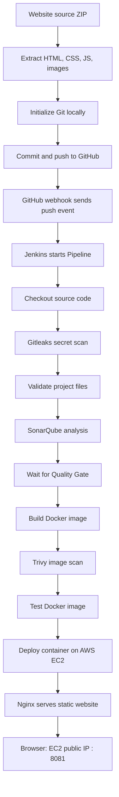
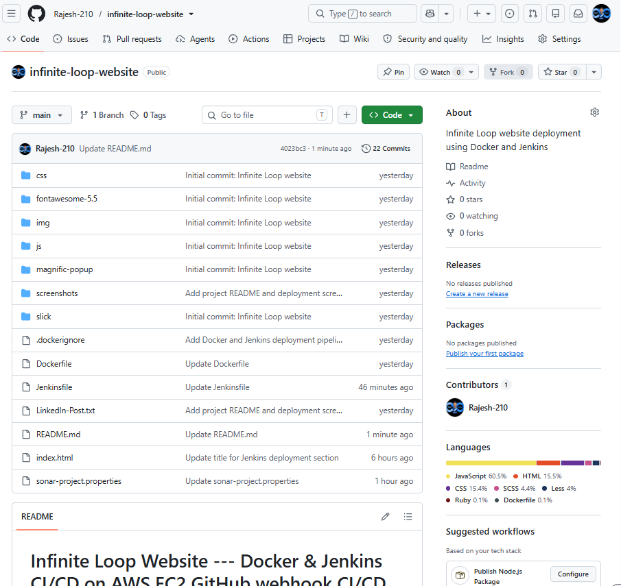
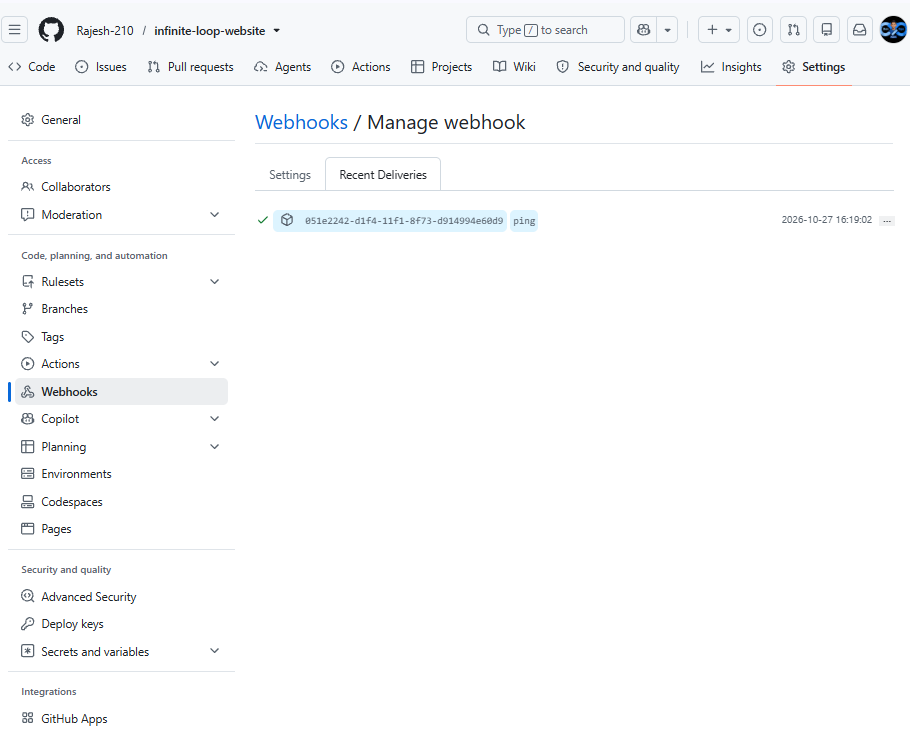
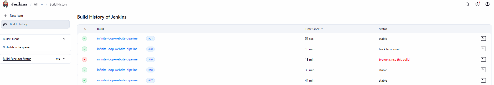
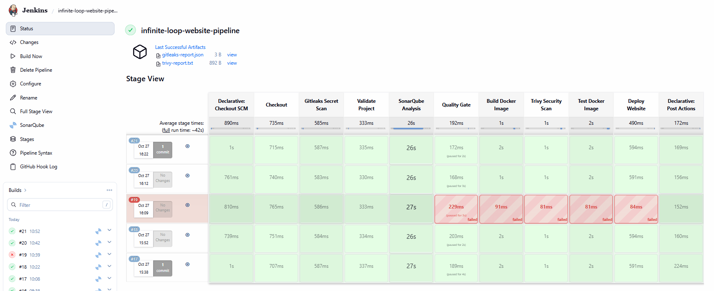
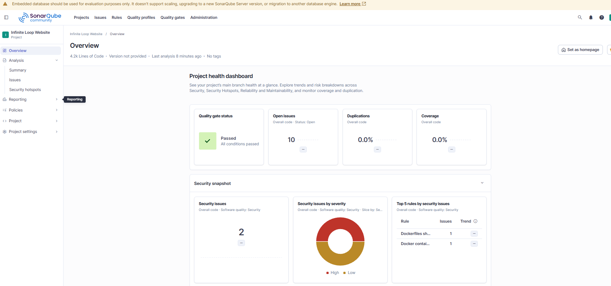
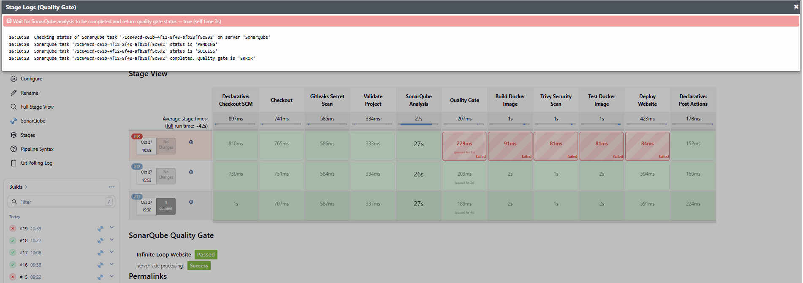
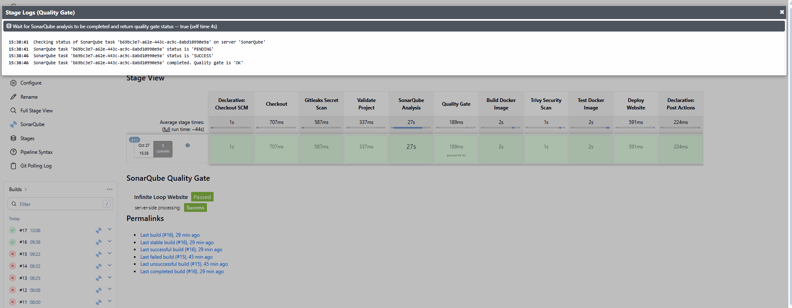

# Infinite Loop Website --- Docker & Jenkins CI/CD on AWS EC2

> A static website deployment project demonstrating a practical CI/CD
> workflow with GitHub, Jenkins, Docker, Nginx, and AWS EC2.

## Project story

This project started with a ZIP file containing a static HTML template.
Instead of stopping at "the website runs on my laptop," I turned it into
a repeatable deployment workflow.

I initialized Git locally, created a GitHub repository, pushed the
website source code, wrote a Dockerfile to package the site, and
configured a Jenkins Pipeline to validate the project, build and test
the Docker image, and deploy the container on an AWS EC2 instance.

The most useful milestone was editing `index.html` directly in GitHub
and watching Jenkins detect the new commit and run the pipeline. The
updated website then appeared in the browser.

## Architecture / flow diagram



### CI/CD stages (current pipeline)

1. **Declarative: Checkout SCM / Checkout:** Jenkins retrieves the latest commit from GitHub.
2. **Gitleaks Secret Scan:** scans the repository for possible exposed secrets and writes `reports/gitleaks-report.json`.
3. **Validate Project:** checks that required website files are present.
4. **SonarQube Analysis:** sends project analysis to the SonarQube server.
5. **Quality Gate:** `waitForQualityGate abortPipeline: true` waits for the analysis result. A failed gate stops the pipeline before image build and deployment.
6. **Build Docker Image:** packages the static website into a Docker image.
7. **Trivy Security Scan:** scans the image for known vulnerabilities and saves `reports/trivy-report.txt`.
8. **Test Docker Image:** verifies the image/container can serve the website.
9. **Deploy Website:** deploys the container on the EC2 host.
10. **Declarative: Post Actions:** runs post-build actions and archives the scan reports.

## Technology stack

-   **Git & GitHub** --- version control and source-code hosting
-   **Jenkins Pipeline** --- CI/CD orchestration
-   **Docker** --- repeatable packaging and runtime
-   **Nginx** --- static website web server
-   **AWS EC2** --- Jenkins/SonarQube and website hosting environment
-   **SonarQube Community Build** --- static analysis and Quality Gate
-   **Gitleaks** --- repository secret scanning
-   **Trivy** --- container image vulnerability scanning
-   **GitHub Webhook** --- push-event notification to Jenkins
-   **HTML, CSS, JavaScript** --- website frontend

## Repository structure

``` text
infinite-loop-website/
├── css/
├── fontawesome-5.5/
├── img/
├── js/
├── magnific-popup/
├── slick/
├── index.html
├── Dockerfile
├── Jenkinsfile
├── .dockerignore
├── README.md
└── screenshots/
```

The `screenshots/` folder in this documentation package contains the
screenshots captured during the setup and verification process. Copy
this folder into the root of your GitHub repository to make the images
render in the README.

## Implementation walkthrough

### 1. Extract and inspect the ZIP

The project was extracted locally and inspected. The source contained
`index.html` and supporting folders for stylesheets, scripts, fonts, and
images.

``` bash
ls
```

Expected key files/folders included:

``` text
css/  fontawesome-5.5/  img/  index.html  js/  magnific-popup/  slick/
```

### 2. Initialize Git

From the project root, initialize the repository and use `main` as the
branch:

``` bash
git init
git branch -M main
git status
git add .
git commit -m "Initial commit: Infinite Loop website"
```

Git may show LF/CRLF line-ending warnings on Windows. These warnings are
common when Git's line-ending settings differ from the files' current
line endings; they are not necessarily errors and do not mean the files
failed to stage.

### 3. Create the GitHub repository and push

Create an empty GitHub repository named `infinite-loop-website` under
your GitHub account. Then connect the local repository and push the
first commit:

``` bash
git remote add origin https://github.com/Rajesh-210/infinite-loop-website.git
git push -u origin main
```

If `origin` already exists, check it before adding it again:

``` bash
git remote -v
```

### 4. Containerize the website

The site is static, so Nginx can serve the HTML, CSS, JavaScript, fonts,
and image assets. The Dockerfile copies the website files into the Nginx
web root and exposes port 80 inside the container.

Example Dockerfile:

``` dockerfile
FROM nginx:alpine
COPY . /usr/share/nginx/html
EXPOSE 80
```

A `.dockerignore` file helps keep unnecessary files out of the build
context. For example:

``` text
.git
.gitignore
README.md
```

If you want the README or screenshots served by the website, do not
exclude them from the Docker build context---or adjust the ignore list
to suit your goal.

### 5. Configure the Jenkins Pipeline

The Jenkins job was configured as a Pipeline and linked to the GitHub
repository. The current pipeline stages visible in Jenkins are:

- Declarative: Checkout SCM
- Checkout
- Gitleaks Secret Scan
- Validate Project
- SonarQube Analysis
- Quality Gate
- Build Docker Image
- Trivy Security Scan
- Test Docker Image
- Deploy Website
- Declarative: Post Actions

The pipeline definition is stored in `Jenkinsfile` and version-controlled with the website. Keep the documentation and screenshots aligned with the committed file.

### 6. Configure the GitHub webhook (completed 27 October 2026)

A webhook was configured in the GitHub repository `Rajesh-210/infinite-loop-website`. The repository's **Settings → Webhooks → Recent Deliveries** page showed a successful ping delivery. More importantly, a later Jenkins console log explicitly reported **“Started by GitHub push by Rajesh-210”**, and Jenkins checked out commit `4023bc3f67befa621fab9c2f3ab07279eabcdace` (`Update README.md`). This confirms that a GitHub push triggered the pipeline.

The Jenkins webhook endpoint used for this integration is conventionally:

```text
http://<JENKINS-REACHABLE-HOST>:8080/github-webhook/
```

Use the actual URL configured in the repository's webhook settings; do not assume the example above proves which exact URL is saved. Jenkins must be reachable from GitHub on the configured endpoint. Restrict network access appropriately and avoid exposing Jenkins broadly to the internet. SCM polling may remain enabled as a fallback if desired.

### 7. Deploy and verify on EC2

The deployed container was named `infinite-loop-website`, built from an
image tag such as `infinite-loop-website:5`, and mapped from EC2 host
port `8081` to Nginx container port `80`.

Check the container:

``` bash
sudo docker ps
```

Check the HTTP response on the EC2 instance:

``` bash
curl -I http://localhost:8081
```

The observed response was:

``` text
HTTP/1.1 200 OK
Server: nginx
Content-Type: text/html
```

You can also check the page HTML:

``` bash
curl -s http://localhost:8081 | grep -i "Infinite Loop"
```

Open the website using:

``` text
http://<EC2-PUBLIC-IP>:8081
```

The public IP and port above are specific to the demonstrated deployment
and may change if the instance is stopped/replaced or the networking
configuration changes.

## Work completed on 27 October 2026

This section records the additional CI/CD work completed today, beyond the initial website container deployment.

### 1. Added security and code-quality stages

The Jenkins pipeline was extended to run Gitleaks, SonarQube analysis, a SonarQube Quality Gate check, and Trivy image scanning. Successful builds also run the Docker image test and deploy the website. The successful Jenkins stage view shows all these stages completing in sequence.

Gitleaks and Trivy reports are archived as build artifacts:

- `reports/gitleaks-report.json`
- `reports/trivy-report.txt`

The observed Gitleaks report contained `[]` for that scan. This means the scan reported no findings in that run; it is not a guarantee that secrets can never exist elsewhere.

### 2. Connected Jenkins to SonarQube

The SonarQube server configured in Jenkins is named `SonarQube` and is reachable from the Jenkins host over the private VPC address `http://172.31.13.35:9000`. Jenkins reached the SonarQube API and received status `UP`. The project key is `infinite-loop-website`.

The SonarQube Analysis stage completes and the Quality Gate stage uses:

```groovy
timeout(time: 5, unit: 'MINUTES') {
    waitForQualityGate abortPipeline: true
}
```

This causes the pipeline to stop when SonarQube reports a failed Quality Gate, rather than continuing to build and deploy an image.

### 3. Tested a Quality Gate failure

A deliberate failure test was run to confirm the gate protects deployment. Jenkins build **#19** showed the Quality Gate stage failing; the downstream **Build Docker Image**, **Trivy Security Scan**, **Test Docker Image**, and **Deploy Website** stages were skipped/marked failed as a consequence of the aborted pipeline. This was a controlled test, not a normal successful deployment.

The subsequent build **#20** passed. After a GitHub push, build **#21** was shown in Jenkins as successful, and its console output began with **“Started by GitHub push by Rajesh-210”**. This is evidence both that the webhook trigger worked and that the pipeline returned to a successful state after the test. Ensure the normal intended Quality Gate is selected in SonarQube after any deliberate test configuration; do not leave an intentionally failing gate active.

### 4. Build evidence observed

- **Build #19:** intentional Quality Gate failure test; later stages did not deploy.
- **Build #20:** successful pipeline run after the test.
- **Build #21:** successful run triggered by a GitHub push.
- **SonarQube project:** `Infinite Loop Website`; dashboard showed approximately 4.2k lines of code, 10 open issues, 2 security issues, and 0.0% coverage at the time of the screenshot. These are snapshot values and can change after future analyses.

## Troubleshooting notes

### Git line-ending warnings on Windows

**Symptom:** Git warns that LF may be replaced by CRLF.

**What it means:** Git is informing you about line-ending conversion on
Windows. If the files stage and commit successfully, the warning alone
is not a failure.

### Jenkins build failures in Docker stages

**Approach:** Open the failed build in Jenkins and inspect **Console
Output**. Identify the first failing command in the
`Build Docker Image`, `Test Docker Image`, or `Deploy Website` stage
rather than relying only on the stage summary.

### Verify the new version is live

**Approach:** Check the image and container with `sudo docker ps`, then
request the local site with `curl`. If the page is correct in `curl` but
appears stale in the browser, try a hard refresh (`Ctrl + F5`).

### Port and security group

The EC2 security group must allow inbound TCP traffic on the port used
by the browser (8081 in this project). Restrict access to trusted IP
ranges where practical. Do not expose Jenkins publicly without
appropriate access controls, and never commit credentials or access
tokens to GitHub.

## Security and production-readiness checklist

-   [x] Configure and verify GitHub push triggering for Jenkins (27 October 2026); review webhook security and network restrictions periodically.
-   [ ] Store credentials in Jenkins Credentials, not in the
    `Jenkinsfile`.
-   [ ] Restrict inbound access to EC2 and Jenkins.
-   [ ] Use HTTPS with a domain name and a reverse proxy or load
    balancer.
-   [ ] Add a deployment health check and rollback strategy.
-   [ ] Clean up unused Docker images safely.
-   [ ] Add a `.gitignore` and ensure no secrets are committed.
-   [ ] Pin and update base images according to a maintenance policy.

## Screenshots

The screenshots below document repository creation, local Git setup, the
website in the browser, Jenkins stages/build history/configuration, and
the EC2 Docker verification. Image files are stored in `screenshots/`.

### Evidence: step-01.png


### Evidence: step-02.png


### Evidence: step-03.png


### Evidence: step-04.png


### Evidence: step-05.png


### Evidence: step-06.png


### Evidence: step-07.png


### Evidence: step-08.png


### Evidence: step-09.png


### Evidence: step-10.png


### Current-day evidence screenshots (27 October 2026)

**GitHub repository and current files**



**GitHub webhook recent deliveries**



**Jenkins build history, including builds #19, #20 and #21**



**Successful pipeline with security and Quality Gate stages**



**SonarQube project dashboard**



**Deliberate Quality Gate failure test**



**Quality Gate failure log**



## Outcome

This project now demonstrates an end-to-end CI/CD workflow from a GitHub push through Jenkins, secret scanning, project validation, SonarQube analysis and Quality Gate enforcement, Docker image creation, Trivy scanning, image testing, and deployment of the Nginx website on AWS EC2. The 27 October 2026 work also verified that a deliberate Quality Gate failure stops downstream deployment stages and that a later GitHub push can trigger a successful pipeline run.

The key learning was not just running a container---it was connecting
source control, automated validation, image creation, deployment, and
verification into a repeatable workflow.

## Author

**Rajesh Chilukuri**\
DevOps \| Git \| Jenkins \| Docker \| AWS EC2 \| Nginx
