# Infinite Loop Website --- Docker & Jenkins CI/CD on AWS EC2 GitHub webhook CI/CD test

> A static website deployment project demonstrating a practical CI/CD
> workflow with GitHub, Jenkins, Docker, Nginx, and AWS EC2.

## Project story

This project started with a ZIP file containing a static HTML template.
Instead of stopping at "the website runs on my laptop," I turned it into
a repeatable deployment workflow.

I initialized Git locally, created a GitHub repository, pushed the
website source code, wrote a Dockerfile to package the site, and
configured a Jenkins Pipeline to validate the project, build and test
the Docker image, and deploy the container on an AWS EC2 instance.

The most useful milestone was editing `index.html` directly in GitHub
and watching Jenkins detect the new commit and run the pipeline. The
updated website then appeared in the browser.

## Architecture / flow diagram

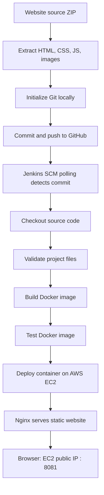

### CI/CD stages

1.  **Source control:** Git tracks the website files and GitHub hosts
    the repository.
2.  **Trigger:** Jenkins polls the Git repository for new commits.
3.  **Checkout:** Jenkins retrieves the latest revision.
4.  **Validation:** The pipeline checks that the expected website files
    are present.
5.  **Build:** Docker packages the static site into an image.
6.  **Test:** The pipeline verifies the image/container can serve the
    site.
7.  **Deploy:** The pipeline replaces/runs the website container on EC2.
8.  **Verify:** Browser and `curl` checks confirm the site is
    responding.

## Technology stack

-   **Git & GitHub** --- version control and source-code hosting
-   **Jenkins Pipeline** --- CI/CD orchestration
-   **Docker** --- repeatable packaging and runtime
-   **Nginx** --- static website web server
-   **AWS EC2** --- deployment host
-   **HTML, CSS, JavaScript** --- website frontend

## Repository structure

``` text
infinite-loop-website/
├── css/
├── fontawesome-5.5/
├── img/
├── js/
├── magnific-popup/
├── slick/
├── index.html
├── Dockerfile
├── Jenkinsfile
├── .dockerignore
├── README.md
└── screenshots/
```

The `screenshots/` folder in this documentation package contains the
screenshots captured during the setup and verification process. Copy
this folder into the root of your GitHub repository to make the images
render in the README.

## Implementation walkthrough

### 1. Extract and inspect the ZIP

The project was extracted locally and inspected. The source contained
`index.html` and supporting folders for stylesheets, scripts, fonts, and
images.

``` bash
ls
```

Expected key files/folders included:

``` text
css/  fontawesome-5.5/  img/  index.html  js/  magnific-popup/  slick/
```

### 2. Initialize Git

From the project root, initialize the repository and use `main` as the
branch:

``` bash
git init
git branch -M main
git status
git add .
git commit -m "Initial commit: Infinite Loop website"
```

Git may show LF/CRLF line-ending warnings on Windows. These warnings are
common when Git's line-ending settings differ from the files' current
line endings; they are not necessarily errors and do not mean the files
failed to stage.

### 3. Create the GitHub repository and push

Create an empty GitHub repository named `infinite-loop-website` under
your GitHub account. Then connect the local repository and push the
first commit:

``` bash
git remote add origin https://github.com/Rajesh-210/infinite-loop-website.git
git push -u origin main
```

If `origin` already exists, check it before adding it again:

``` bash
git remote -v
```

### 4. Containerize the website

The site is static, so Nginx can serve the HTML, CSS, JavaScript, fonts,
and image assets. The Dockerfile copies the website files into the Nginx
web root and exposes port 80 inside the container.

Example Dockerfile:

``` dockerfile
FROM nginx:alpine
COPY . /usr/share/nginx/html
EXPOSE 80
```

A `.dockerignore` file helps keep unnecessary files out of the build
context. For example:

``` text
.git
.gitignore
README.md
```

If you want the README or screenshots served by the website, do not
exclude them from the Docker build context---or adjust the ignore list
to suit your goal.

### 5. Configure the Jenkins Pipeline

The Jenkins job was configured as a Pipeline and linked to the GitHub
repository. The pipeline stages visible in Jenkins were:

-   Declarative: Checkout SCM
-   Checkout
-   Validate Project
-   Build Docker Image
-   Test Docker Image
-   Deploy Website
-   Declarative: Post Actions

The pipeline definition is stored in the repository as `Jenkinsfile`, so
the build and deployment steps are version-controlled alongside the
application.

> Note: Keep the `Jenkinsfile` in sync with the actual pipeline in your
> repository. The stage names above reflect the workflow shown in the
> Jenkins screenshots; exact shell commands depend on the final
> committed file.

### 6. Configure automatic triggering

SCM polling was enabled in Jenkins with this schedule:

``` text
H/2 * * * *
```

This means Jenkins checks for source changes approximately every two
minutes, with the exact minute offset determined by Jenkins. It is
polling rather than an instant push notification. A GitHub webhook can
be configured later for near-immediate triggering, provided the Jenkins
endpoint is reachable and webhook security is configured.

### 7. Deploy and verify on EC2

The deployed container was named `infinite-loop-website`, built from an
image tag such as `infinite-loop-website:5`, and mapped from EC2 host
port `8081` to Nginx container port `80`.

Check the container:

``` bash
sudo docker ps
```

Check the HTTP response on the EC2 instance:

``` bash
curl -I http://localhost:8081
```

The observed response was:

``` text
HTTP/1.1 200 OK
Server: nginx
Content-Type: text/html
```

You can also check the page HTML:

``` bash
curl -s http://localhost:8081 | grep -i "Infinite Loop"
```

Open the website using:

``` text
http://<EC2-PUBLIC-IP>:8081
```

The public IP and port above are specific to the demonstrated deployment
and may change if the instance is stopped/replaced or the networking
configuration changes.

## Troubleshooting notes

### Git line-ending warnings on Windows

**Symptom:** Git warns that LF may be replaced by CRLF.

**What it means:** Git is informing you about line-ending conversion on
Windows. If the files stage and commit successfully, the warning alone
is not a failure.

### Jenkins build failures in Docker stages

**Approach:** Open the failed build in Jenkins and inspect **Console
Output**. Identify the first failing command in the
`Build Docker Image`, `Test Docker Image`, or `Deploy Website` stage
rather than relying only on the stage summary.

### Verify the new version is live

**Approach:** Check the image and container with `sudo docker ps`, then
request the local site with `curl`. If the page is correct in `curl` but
appears stale in the browser, try a hard refresh (`Ctrl + F5`).

### Port and security group

The EC2 security group must allow inbound TCP traffic on the port used
by the browser (8081 in this project). Restrict access to trusted IP
ranges where practical. Do not expose Jenkins publicly without
appropriate access controls, and never commit credentials or access
tokens to GitHub.

## Security and production-readiness checklist

-   [ ] Use a GitHub webhook with appropriate authentication and network
    restrictions.
-   [ ] Store credentials in Jenkins Credentials, not in the
    `Jenkinsfile`.
-   [ ] Restrict inbound access to EC2 and Jenkins.
-   [ ] Use HTTPS with a domain name and a reverse proxy or load
    balancer.
-   [ ] Add a deployment health check and rollback strategy.
-   [ ] Clean up unused Docker images safely.
-   [ ] Add a `.gitignore` and ensure no secrets are committed.
-   [ ] Pin and update base images according to a maintenance policy.

## Screenshots

The screenshots below document repository creation, local Git setup, the
website in the browser, Jenkins stages/build history/configuration, and
the EC2 Docker verification. Image files are stored in `screenshots/`.

### Evidence: step-01.png

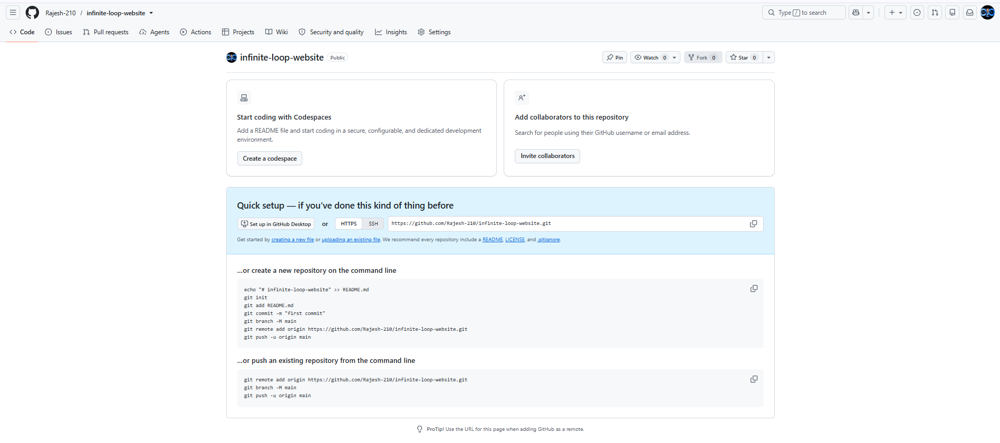

### Evidence: step-02.png

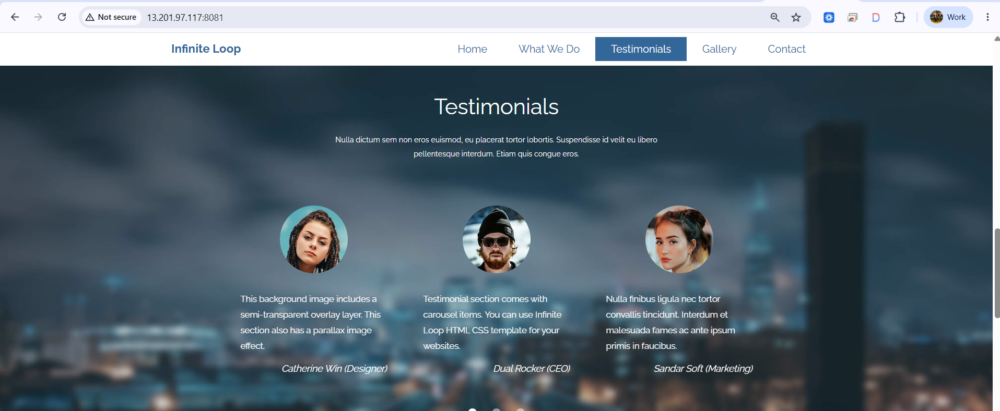

### Evidence: step-03.png

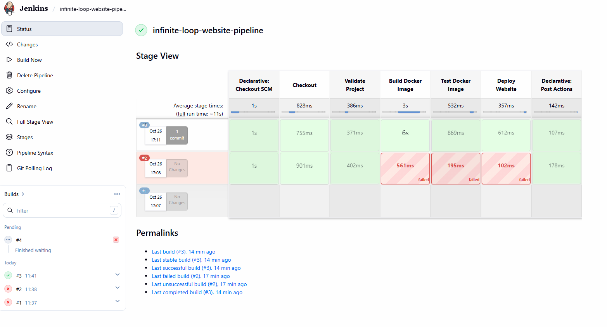

### Evidence: step-04.png

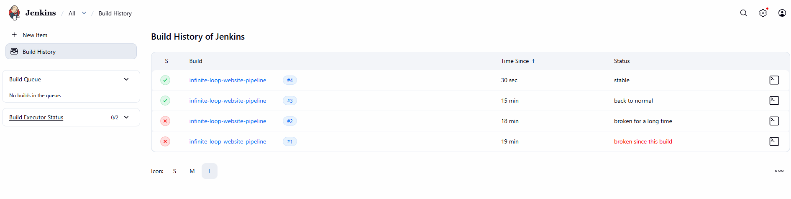

### Evidence: step-05.png

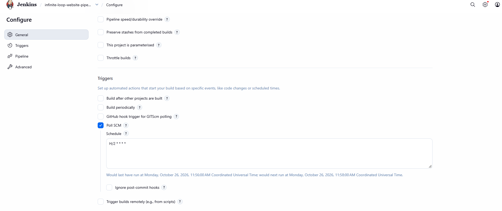

### Evidence: step-06.png

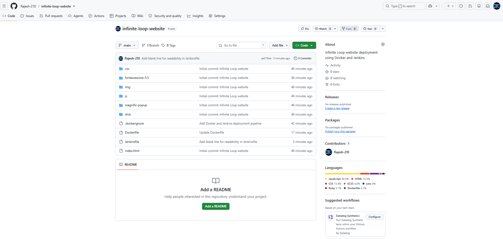

### Evidence: step-07.png

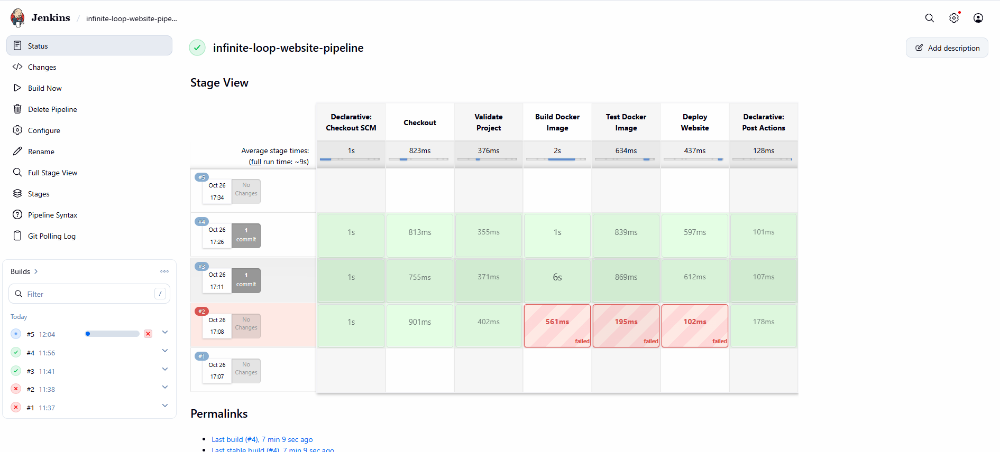

### Evidence: step-08.png

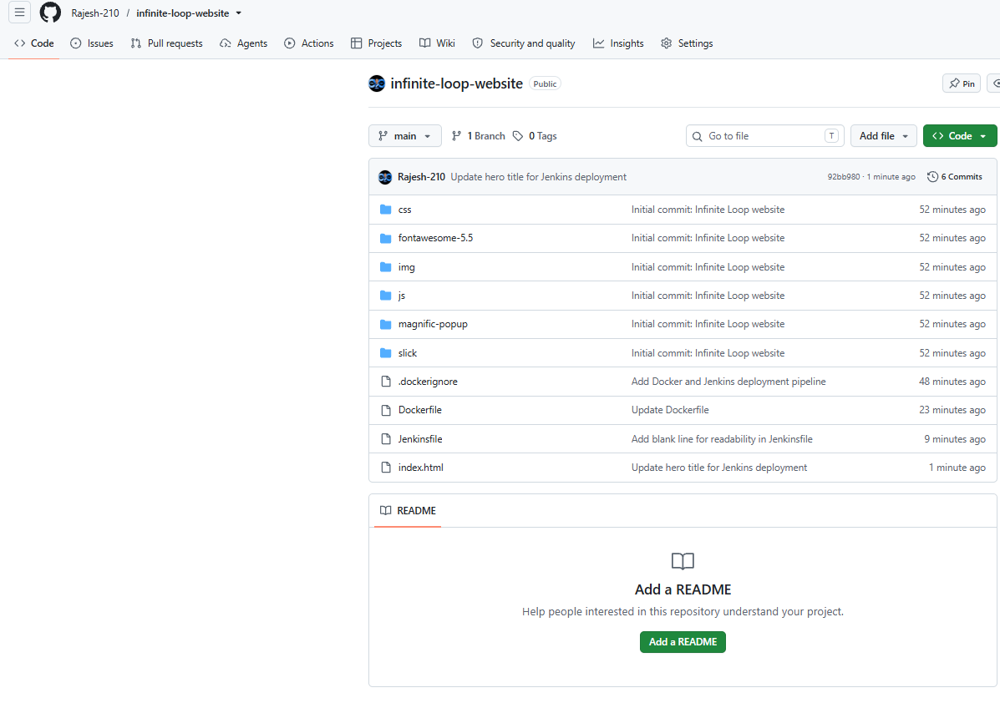

### Evidence: step-09.png

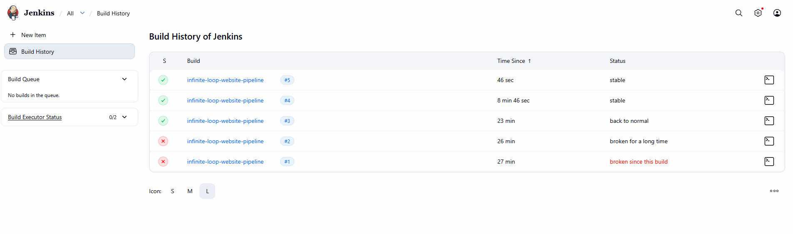

### Evidence: step-10.png

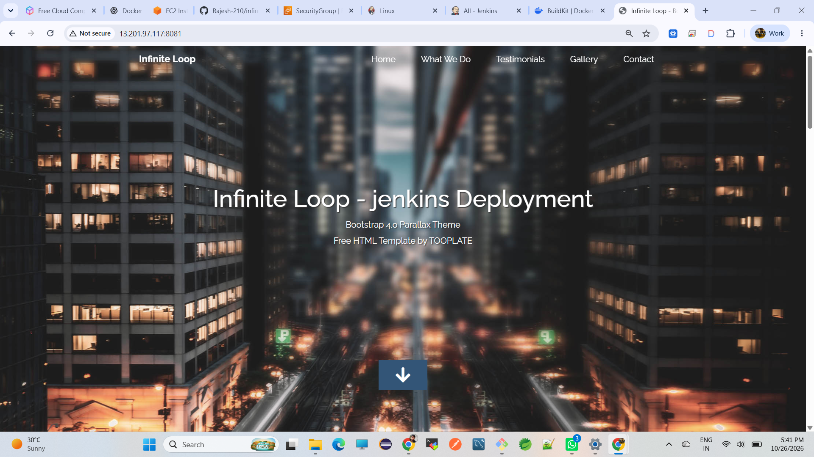

## Outcome

This project demonstrates the end-to-end path from a ZIP-based static
website to a Git-managed, Docker-packaged deployment automated by
Jenkins on AWS EC2.

The key learning was not just running a container---it was connecting
source control, automated validation, image creation, deployment, and
verification into a repeatable workflow.

## Author

**Rajesh Chilukuri**\
DevOps \| Git \| Jenkins \| Docker \| AWS EC2 \| Nginx
