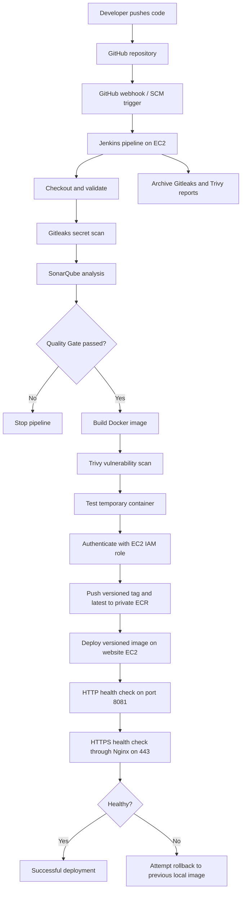
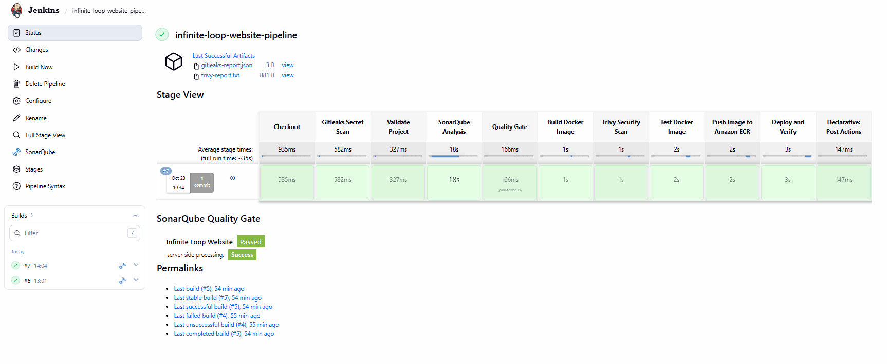
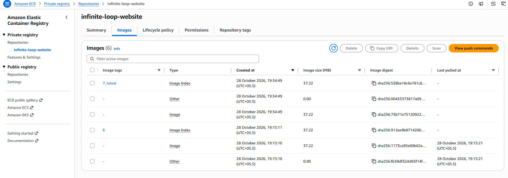
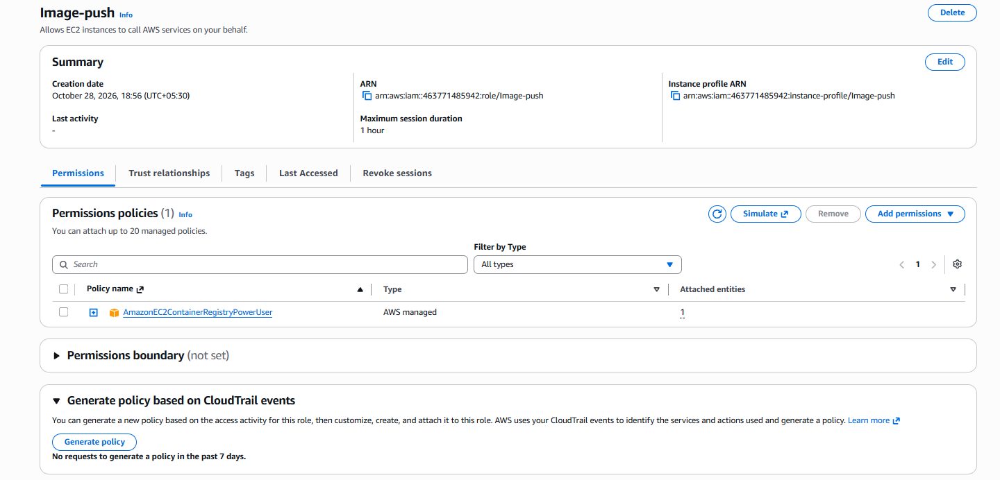
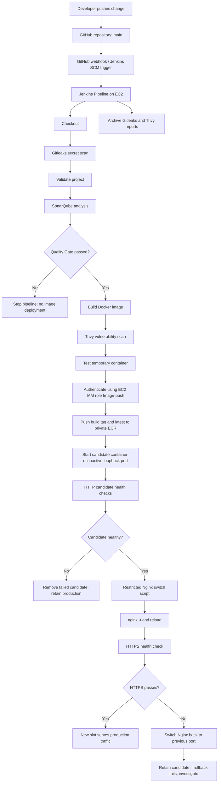
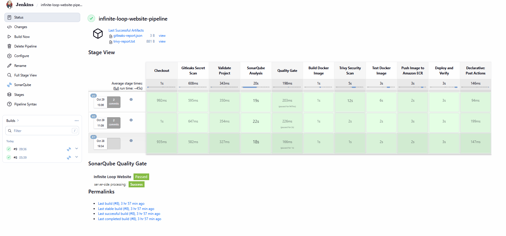

# Infinite Loop Website --- CI/CD on AWS

A static website deployment project demonstrating an automated CI/CD
pipeline using GitHub, Jenkins, Docker, SonarQube, Gitleaks, and Trivy.

**Repository:** https://github.com/Rajesh-210/infinite-loop-website\
**Jenkins job:** `infinite-loop-website-pipeline`\
**Default branch observed:** `main`

> **Verification status:** Build #21 was triggered by a GitHub push
> (`Update README.md`) and all displayed pipeline stages passed. Build
> #19 was used to test Quality Gate failure; later build/deployment
> stages did not proceed.

## Table of contents

-   [Overview](#overview)
-   [Architecture](#architecture)
-   [Technology stack](#technology-stack)
-   [Pipeline stages](#pipeline-stages)
-   [Repository structure](#repository-structure)
-   [Configuration](#configuration)
-   [GitHub webhook](#github-webhook)
-   [Quality Gate test](#quality-gate-test)
-   [Security reports](#security-reports)
-   [Troubleshooting](#troubleshooting)
-   [Security recommendations](#security-recommendations)
-   [Future improvements](#future-improvements)

## Overview

The project automates the deployment of the Infinite Loop Website. A
GitHub push triggers Jenkins, which checks out the source, scans for
secrets, analyzes code quality, enforces a SonarQube Quality Gate,
builds and scans a Docker image, tests the image, deploys the website,
and archives scan reports.

### Objectives

-   Trigger builds automatically from GitHub push events.
-   Scan source files for potential secrets with Gitleaks.
-   Analyze the project with SonarQube and enforce its Quality Gate.
-   Build a Docker image for the website.
-   Scan the image for known vulnerabilities using Trivy.
-   Test the container before deployment.
-   Archive security reports in Jenkins.

## Architecture



### Current infrastructure and endpoints (observed 28 October 2026)

- Website EC2 public IP: `43.204.97.216`
- Public website: `https://43.204.97.216`
- Website container: `infinite-loop-website`, host port `8081` mapped to container port `80`
- System Nginx terminates HTTPS on ports `80/443` and forwards/serves the application as configured.
- Jenkins job: `infinite-loop-website-pipeline`; the Jenkins UI was previously accessed on port `8080`. Restrict access to trusted addresses.
- SonarQube EC2 public IP observed earlier: `16.4.79.185`, UI port `9000`; keep this administrative interface restricted.
- AWS account: `463771485942`; region: `ap-south-1` (Mumbai).
- EC2 IAM role: `Image-push`. Jenkins successfully used the role to call STS and authenticate to ECR without static AWS access keys.
- Private ECR repository: `463771485942.dkr.ecr.ap-south-1.amazonaws.com/infinite-loop-website`.

IP addresses and ports are environment-specific and can change. Do not treat this documentation as a substitute for checking current EC2, DNS, and security-group configuration.

### Infrastructure

Two separate EC2 instances were used in the same AWS VPC:

  -----------------------------------------------------------------------
  Component               Role                    Port / notes
  ----------------------- ----------------------- -----------------------
  Jenkins EC2             Runs Jenkins and the    UI on `8080`; restrict
                          pipeline                access

  SonarQube EC2           Code analysis and       UI on `9000`; restrict
                          Quality Gate            access

  Docker                  Packages and runs the   Website was previously
                          static website          exposed on host port
                                                  `8081`

  GitHub                  Source control and      HTTPS
                          webhook event source    

  Gitleaks / Trivy        Source-secret and       Executed in the
                          image-vulnerability     pipeline
                          scanning                
  -----------------------------------------------------------------------

The Jenkins host was observed at private IP `172.31.1.96`; SonarQube at
`172.31.13.35`. These are environment-specific values, not permanent
addresses.

## Technology stack

-   AWS EC2 and VPC
-   Ubuntu
-   Git and GitHub
-   Jenkins Declarative Pipeline
-   Docker
-   Nginx Alpine
-   SonarQube Community Build and SonarScanner
-   Gitleaks
-   Trivy

## Pipeline stages

  -----------------------------------------------------------------------
  Stage                               Purpose
  ----------------------------------- -----------------------------------
  Declarative: Checkout SCM /         Retrieves the repository and
  Checkout                            selected commit

  Gitleaks Secret Scan                Searches the repository for
                                      potential secrets

  Validate Project                    Checks required project files and
                                      structure

  SonarQube Analysis                  Runs static analysis and submits
                                      results

  Quality Gate                        Waits for SonarQube's quality
                                      decision

  Build Docker Image                  Builds the website image

  Trivy Security Scan                 Scans the image for known
                                      vulnerabilities

  Test Docker Image                   Tests the built image/container

  Push Image to Amazon ECR            Pushes versioned and latest tags to private ECR

  Deploy and Verify                   Deploys the versioned image; checks HTTP/HTTPS and attempts rollback

  Declarative: Post Actions           Archives scan reports and runs
                                      post-build actions
  -----------------------------------------------------------------------

The Quality Gate stage uses `waitForQualityGate abortPipeline: true`. If
the gate fails, the pipeline should stop before Docker build and
deployment.

## Repository structure

Observed repository items include:

``` text
infinite-loop-website/
├── css/
├── fontawesome-5.5/
├── img/
├── js/
├── magnific-popup/
├── screenshots/
├── slick/
├── .dockerignore
├── Dockerfile
├── Jenkinsfile
├── LinkedIn-Post.txt
├── README.md
├── index.html
└── sonar-project.properties
```

This is a summary of the visible structure, not a complete listing.

## Configuration

### Jenkins

-   Job: `infinite-loop-website-pipeline`
-   The `Jenkinsfile` is stored in the GitHub repository.
-   Under **Configure → Build Triggers**, enable **GitHub hook trigger
    for GITScm polling**.
-   Configure the SonarQube server in Jenkins and use
    `withSonarQubeEnv('SonarQube')` for analysis.
-   Keep credentials and tokens in Jenkins Credentials, not in source
    files.

### SonarQube

-   Jenkins server configuration name: `SonarQube`
-   Project key observed: `infinite-loop-website`
-   The Jenkins and SonarQube hosts communicated over the VPC private
    network.
-   Use the exact same project key in `sonar-project.properties` and
    SonarQube. An earlier case-sensitive project-key mismatch caused an
    analysis error before it was resolved.

### Dockerfile

The observed Dockerfile:

``` dockerfile
FROM nginx:alpine
RUN apk update && apk upgrade --no-cache
COPY . /usr/share/nginx/html/
EXPOSE 80
CMD ["nginx", "-g", "daemon off;"]
```

It uses Nginx Alpine, upgrades Alpine packages, copies the website into
Nginx's document root, and runs Nginx in the foreground.

## GitHub webhook

The webhook is configured to send push events to Jenkins. A real push
was confirmed by the Jenkins console output:

``` text
Started by GitHub push by Rajesh-210
```

The log also showed Jenkins retrieving the `Jenkinsfile` and checking
out the `main` branch commit with message `Update README.md`.

### Setup checklist

1.  In Jenkins, open the pipeline job and select **Configure**.
2.  Under **Build Triggers**, enable **GitHub hook trigger for GITScm
    polling**.
3.  In GitHub, open **Repository Settings → Webhooks** and add the
    Jenkins webhook endpoint.
4.  Use `application/json` and select the **push** event.
5.  Confirm the webhook is active and inspect **Recent Deliveries**.
6.  Push a small change and confirm Jenkins reports
    `Started by GitHub push`.

The initial `ping` delivery succeeded, and a real push event was
subsequently confirmed.

> **Security note:** The initial webhook endpoint used HTTP. For
> production use, place Jenkins behind HTTPS and restrict inbound
> access. Avoid exposing the Jenkins administrative interface broadly to
> the internet.

## Quality Gate test

Build #19 was used to test a deliberately failing Quality Gate. The
analysis task completed, but the gate returned `ERROR`:

``` text
SonarQube task status is 'PENDING'
SonarQube task status is 'SUCCESS'
SonarQube task completed. Quality gate is 'ERROR'
```

This shows that the analysis task can succeed while the Quality Gate
rejects the result. The later Docker build, Trivy scan, image test, and
deployment stages were marked failed/skipped in the stage view.

After restoring the normal Quality Gate, build #20 passed. Build #21,
triggered by a GitHub push, also passed all displayed stages.

When testing a deliberately failing gate: - Use a separate test Quality
Gate where possible. - Record the original project gate before changing
it. - Restore the original gate after the test. - Run a new build to
verify the normal path.

## Security reports

The pipeline archives these reports:

``` text
reports/gitleaks-report.json
reports/trivy-report.txt
```

-   **Gitleaks:** A previously archived report contained `[]`, meaning
    that scan reported no findings in that run. This does not prove
    secrets cannot exist elsewhere in the repository or its history.
-   **Trivy:** Review the report for vulnerabilities and remediate
    applicable findings. A green scan stage does not necessarily mean
    the image has zero vulnerabilities; results depend on the scan
    policy and exit-code configuration.

Open the Jenkins build page and select the archived artifacts to inspect
them.

## Deployment verification

After a successful run:

1.  Confirm the **Deploy Website** stage is green.
2.  Open the current website endpoint and check that the page loads.
3.  Verify the latest code change is visible.
4.  If the site is unavailable, inspect the running container, port
    mapping, EC2 security group, firewall, and container logs.
5.  Confirm both scan reports are archived.

The website was previously tested on host port `8081`. Verify the
current EC2 public IP and security-group rules before using an endpoint;
public IPs may change.

## Troubleshooting

  -----------------------------------------------------------------------
  Issue                               Observation / resolution
  ----------------------------------- -----------------------------------
  Jenkins could not access Docker     A Docker socket permission error
                                      occurred. The Jenkins user was
                                      added to the Docker group and
                                      Jenkins restarted; image builds
                                      then succeeded.

  SonarQube authorization or          Align the Jenkins credential/server
  project-key error                   configuration and exact project
                                      key. Later analyses passed after
                                      the configuration was corrected.

  Quality Gate failure                Build #19 returned
                                      `Quality gate is 'ERROR'`. This was
                                      expected during the failure test;
                                      restore the normal gate and rerun.

  Webhook ping succeeded but build    A ping alone is insufficient.
  did not trigger                     Verify a real push delivery and
                                      look for `Started by GitHub push`
                                      in Jenkins. This was subsequently
                                      confirmed.

  Website is unreachable              Check the deployment stage,
                                      container status, port mapping,
                                      security-group inbound rules, and
                                      host firewall.

  Scan results need investigation     Open the archived Gitleaks/Trivy
                                      report and inspect the
                                      corresponding build logs.
  -----------------------------------------------------------------------

## Security recommendations

-   Use HTTPS for Jenkins and SonarQube where appropriate.
-   Restrict administrative interfaces to trusted IPs, VPN, or private
    networking.
-   Store tokens in Jenkins Credentials; never commit secrets.
-   Use least-privilege AWS IAM permissions.
-   Do not expose the Docker daemon socket over an unauthenticated
    network.
-   Review Trivy findings and update base images regularly.
-   Protect the default branch and require review for important changes.
-   Back up Jenkins configuration and important SonarQube data.
-   SonarQube displayed a warning that its embedded database is for
    evaluation purposes. Consider a supported external database for
    long-term or production use.
-   Rotate any credential that may have been exposed in logs, files, or
    screenshots.

## Future improvements

-   Configure HTTPS and tighter network access for Jenkins and
    SonarQube.
-   Add website tests and deployment health checks.
-   Add notifications for failed builds and security findings.
-   Tag images using the Git commit SHA and define a cleanup policy.
-   Add rollback handling.
-   Monitor EC2 health, disk usage, containers, and service
    availability.
-   Document recovery commands and maintain a sanitized architecture
    diagram.

## Verification summary

  -----------------------------------------------------------------------
  Build                               Result
  ----------------------------------- -----------------------------------
  #17                                 Successful pipeline run

  #18                                 Successful pipeline run using the
                                      normal Quality Gate

  #19                                 Deliberate Quality Gate failure;
                                      later delivery stages did not
                                      proceed

  #20                                 Successful run after restoring the
                                      normal Quality Gate

  #21                                 Triggered by GitHub push
                                      (`Update README.md`); all displayed
                                      stages passed
  -----------------------------------------------------------------------

These results reflect the environment at the time of testing. Re-run the
pipeline after infrastructure, credentials, dependencies, or
configuration change.

------------------------------------------------------------------------

**Maintainer:** Rajesh\
**Repository:** https://github.com/Rajesh-210/infinite-loop-website


## Work completed on 28 October 2026 — HTTPS, IAM, ECR, and CI/CD integration

This section extends the previous project record rather than replacing the earlier setup notes.

### 1. HTTPS certificate for the public IP

The website was configured to serve HTTPS at `https://43.204.97.216`. This environment used a Let's Encrypt short-lived IP-address certificate (not a domain-name certificate). System Nginx listens on ports 80 and 443; HTTP redirects to HTTPS. Certbot was installed with Snap (observed version `5.8.0`), and its renewal timer was present. A `certbot renew --dry-run` check succeeded. At the time observed, the certificate expiry was around 4 November 2026, so renewal must remain automated.

**Recorded certificate issuance procedure** (use the current public IP and confirm the Certbot version/profile options in the official documentation before repeating):

1. Install Nginx and ensure it is active, with inbound TCP ports 80 and 443 allowed in the EC2 security group.
2. Install Certbot using the supported Snap procedure for Ubuntu and verify `certbot --version`.
3. Ensure the ACME webroot exists and is served over HTTP:

   ```bash
   sudo mkdir -p /var/www/html/.well-known/acme-challenge
   echo acme-test | sudo tee /var/www/html/.well-known/acme-challenge/test-file
   curl http://43.204.97.216/.well-known/acme-challenge/test-file
   ```

   The challenge URL must return the test text before certificate issuance. Remove the test file after testing.

4. The command used in this project to request the short-lived IP certificate was:

   ```bash
   sudo certbot certonly --preferred-profile shortlived \\
     --webroot --webroot-path /var/www/html \\
     --ip-address 43.204.97.216
   ```

5. Configure Nginx to use the certificate and private key paths reported by Certbot. Keep the HTTP server able to serve `/.well-known/acme-challenge/` from `/var/www/html` while redirecting other HTTP requests to HTTPS. Validate and reload Nginx only after confirming the config:

   ```bash
   sudo nginx -t
   sudo systemctl reload nginx
   ```

6. Verify HTTPS and the redirect:

   ```bash
   curl -I http://43.204.97.216
   curl -I https://43.204.97.216
   sudo certbot certificates
   sudo certbot renew --dry-run
   systemctl list-timers | grep -i certbot
   ```

   The observed HTTPS response was `HTTP/1.1 200 OK`; the browser showed the connection as secure. The renewal dry run passed.

**Renewal warning:** IP certificates issued with the short-lived profile expire quickly (the observed certificate had roughly a one-week validity). Do not rely on manual renewal. Confirm the Certbot timer is enabled and monitor renewal logs. Do not delete or overwrite certificate files manually. Certificate options and eligibility can change; consult [Certbot documentation](https://certbot.eff.org/) and [Let's Encrypt documentation](https://letsencrypt.org/docs/) before repeating these steps.

### 2. AWS CLI and IAM role troubleshooting

- Installed AWS CLI v2; observed version: `aws-cli/2.39.0`.
- Initially `aws` was not installed; after installation, STS returned `NoCredentials`.
- Created/attached the EC2 IAM role `Image-push`, allowing the instance to obtain temporary credentials from the EC2 role rather than storing long-lived AWS access keys.
- Verified from the Ubuntu user and from the Jenkins service user:

  ```bash
  aws sts get-caller-identity
  sudo -u jenkins aws sts get-caller-identity
  ```

  Both identified AWS account `463771485942` and the assumed role `Image-push`.
- Set the region to `ap-south-1`. `aws ecr describe-repositories` initially returned an empty repository list, which was expected because the repository did not yet exist.
- Repository creation first failed with `AccessDeniedException` because the role lacked `ecr:CreateRepository`. Added a small inline policy allowing `ecr:CreateRepository`, then creation succeeded. The role also has `AmazonEC2ContainerRegistryPowerUser` for repository image operations. The policy should be reviewed and narrowed to the project’s needs where practical. Do not attach all three ECR Public policies for this private-repository workflow.

### 3. Created private ECR repository and pushed image 6

Repository settings:

```text
Region:          ap-south-1
Repository:      infinite-loop-website
Repository URI:  463771485942.dkr.ecr.ap-south-1.amazonaws.com/infinite-loop-website
Image scanning:  scanOnPush=true
Encryption:      AES256
```

The local image `infinite-loop-website:6` was tagged and pushed as `:6` and `:latest`. Both tags resolved to digest `sha256:912ee9b87142065653b129ca5348d168ce84adb6d359ed874f332316c82e75b5`.

Example commands used:

```bash
aws ecr get-login-password --region ap-south-1 | \\
  sudo docker login --username AWS --password-stdin \\
  463771485942.dkr.ecr.ap-south-1.amazonaws.com

sudo docker tag infinite-loop-website:6 \\
  463771485942.dkr.ecr.ap-south-1.amazonaws.com/infinite-loop-website:6
sudo docker push \\
  463771485942.dkr.ecr.ap-south-1.amazonaws.com/infinite-loop-website:6
```

### 4. Jenkins integration with private ECR

The Jenkins service runs as Linux user `jenkins`, which belongs to the `docker` group. These checks passed:

```bash
ps -o user,group,comm -C java
sudo -u jenkins aws sts get-caller-identity
sudo -u jenkins docker ps
id jenkins
```

The existing Jenkinsfile was updated to add the **Push Image to Amazon ECR** stage after image scanning and testing. It authenticates with `aws ecr get-login-password`, tags the build-number image (Jenkins build `#7` produced tag `:7`), and pushes both `:7` and `:latest`. The deployment stage uses the versioned image and verifies HTTP and HTTPS. The `Deploy and Verify` stage retains an attempt to restart the previous local image if verification fails.

**Important operational note:** Docker printed a warning that credentials were stored unencrypted in `/var/lib/jenkins/.docker/config.json`. Login succeeded, but consider configuring a supported Docker credential helper and ensure the Jenkins home directory is appropriately protected. ECR authorization tokens are temporary; the pipeline logs in at push time.

### 5. Build #7 verification

Jenkins build `#7` was green. The displayed stages passed: Checkout, Gitleaks Secret Scan, Validate Project, SonarQube Analysis, Quality Gate, Build Docker Image, Trivy Security Scan, Test Docker Image, Push Image to Amazon ECR, Deploy and Verify, and post actions. The SonarQube Quality Gate was shown as **Passed** with server-side processing **Success**.

ECR showed tags `7`, `latest`, and `6`. Build #7 pushed tags `7` and `latest` with digest:

```text
sha256:538be18c6e781c61db6a1f226c10624a4ee22f855dbd39e300fe4172851b8cf5
```

The repository also showed untagged image artifacts/digests. They have not been deleted; review them before setting an ECR lifecycle policy.

### 6. Rollback test status

An isolated rollback test was performed using a temporary container on port `18081`. It simulated a failed health check, restored `infinite-loop-website:3`, and reported `ROLLBACK TEST SUCCESSFUL`. The live website container remained `infinite-loop-website:6` at that time and the HTTPS check returned `200 OK`. This verifies the isolated rollback procedure, but **does not prove that Jenkins’ full automatic rollback path has been triggered by a real failed deployment**. A controlled Jenkins rollback test remains a future task.

### 7. Screenshots and evidence

The `screenshots/` directory in the documentation package contains the earlier setup evidence plus the latest screenshots:

- `jenkins-pipeline-build-7.png` — Jenkins build #7 with ECR push and deployment stages green.
- `ecr-images-build-7.png` — ECR repository showing tags `7`, `latest`, and `6`.
- `iam-image-push-role.png` — IAM role with `AmazonEC2ContainerRegistryPowerUser` attached.
- Earlier screenshots cover GitHub, Jenkins, SonarQube, Quality Gate testing, and project setup.

### Latest evidence screenshots

**Jenkins build #7 — ECR push and deployment passed**



**Amazon ECR — versioned tags**



**IAM role permissions**



For GitHub rendering, preserve the relative `screenshots/...` paths and commit the screenshot folder alongside this README.

## Updated troubleshooting record

| Issue | Cause | Resolution / status |
|---|---|---|
| `aws: command not found` | AWS CLI was absent | Installed AWS CLI v2 and verified version. |
| STS `NoCredentials` | No EC2 role credentials were available at first | Attached/used EC2 role `Image-push`; STS worked for both Ubuntu and Jenkins users. |
| `ecr:CreateRepository` AccessDenied | Role lacked repository-creation permission | Added inline `ecr:CreateRepository` permission; repository creation succeeded. |
| ECR repository list empty | No private repository existed yet in `ap-south-1` | Created `infinite-loop-website`. |
| Docker credential storage warning | Docker CLI stores login data in config without a credential helper | Login and push succeeded; credential-helper hardening remains recommended. |
| Initial container health check connection reset | Container was still starting | Pipeline retries health checks; subsequent HTTP and HTTPS checks passed. |

## Next session checklist

1. Review untagged ECR images and decide on a conservative lifecycle policy; do not expire the currently deployed or rollback-required image.
2. Consider configuring a Docker credential helper for Jenkins.
3. Perform a carefully controlled Jenkins deployment-failure test and confirm automatic rollback end to end.
4. Recheck Certbot timer, certificate expiry, `sudo certbot renew --dry-run`, and HTTPS response.
5. Continue monitoring storage, disk space, and scan findings.


---

# Work completed on 29 October 2026 — Blue-Green deployment and rollback verification

This section extends the existing project history. The current configuration below supersedes earlier endpoint/port snapshots where they differ. Public IP addresses are ephemeral in this practice environment and can change after an EC2 stop/start.

## 1. Current observed environment (29 October 2026)

| Item | Current observed value |
|---|---|
| GitHub repository | `Rajesh-210/infinite-loop-website` |
| Jenkins pipeline | `infinite-loop-website-pipeline` |
| AWS Region | `ap-south-1` (Mumbai) |
| AWS account | `463771485942` |
| Website/Jenkins EC2 public IP observed today | `15.206.149.132` |
| Website/Jenkins EC2 private IP observed today | `172.31.15.124` |
| SonarQube EC2 public IP observed in this session | `15.206.210.167` |
| SonarQube EC2 private IP observed in this session | `172.31.5.173` |
| Jenkins UI | Port `8080` (restrict access) |
| SonarQube UI | Port `9000` (restrict access; Jenkins uses private IP) |
| Current production image | `463771485942.dkr.ecr.ap-south-1.amazonaws.com/infinite-loop-website:9` |
| Current active production port | `8082` (Green) |
| Previous retained container | `infinite-loop-website`, image `:8`, port `8081` (Blue) |
| HTTPS URL tested | `https://15.206.149.132` |

Do not assume these addresses will remain the same. Confirm the EC2 public/private IPs and update the Jenkinsfile's `WEBSITE_IP`, Nginx certificate paths, webhook settings, and other dependent configuration if the public IP changes. The current HTTPS check used `curl -k`, which skips certificate trust/hostname verification; use a normal `curl -I https://<current-endpoint>` check to validate certificate trust as well.

## 2. Updated architecture and deployment flow



### Blue-Green port map

| Slot | Container name | Host binding | Image during Build #9 | Role after Build #9 |
|---|---|---|---|---|
| Blue | `infinite-loop-website` | `0.0.0.0:8081->80` | `:8` | Previous/rollback slot |
| Green | `infinite-loop-green` | `127.0.0.1:8082->80` | `:9` | Active production slot |

The candidate container binds to loopback, so it is reached through local health checks and system Nginx rather than directly through a public host port. Nginx terminates HTTPS and proxies to the active slot. Both containers remain running after a successful switch so the previous slot can be restored quickly.

## 3. Jenkins Build #9 — successful Blue-Green deployment

On 29 October 2026, Jenkins Build `#9` completed all displayed stages successfully:

1. Checkout
2. Gitleaks Secret Scan
3. Validate Project
4. SonarQube Analysis
5. Quality Gate
6. Build Docker Image
7. Trivy Security Scan
8. Test Docker Image
9. Push Image to Amazon ECR
10. Deploy and Verify
11. Declarative: Post Actions

The deploy stage detected Nginx's active port as `8081`, selected port `8082` for Green, pulled/used the versioned ECR image `:9`, started `infinite-loop-green`, and checked `http://127.0.0.1:8082/`. The first request received `curl: (56) Recv failure: Connection reset by peer` while the container was starting; the retry loop succeeded on the next attempt. The pipeline then ran the restricted Nginx switch script and passed the HTTPS verification.

Key final console output:

```text
Candidate HTTP health check passed.
SUCCESS: Nginx switched to port 8082.
SUCCESS: HTTPS health check passed.
SUCCESS: Blue-Green deployment completed.
Active production port: 8082
Previous production port: 8081
Previous production container retained: infinite-loop-website
```

## 4. Active port detection fix

The deploy stage reads the Nginx site configuration as the `jenkins` user. The `NGINX_SITE` variable is defined inside the Jenkins shell stage:

```bash
NGINX_SITE="/etc/nginx/sites-available/default"

ACTIVE_PORT=$(grep -oE \
    'proxy_pass http://127[.]0[.]0[.]1:(8081|8082);' \
    "$NGINX_SITE" |
    head -n 1 |
    grep -oE '8081|8082' || true)

if [ "$ACTIVE_PORT" != "8081" ] && [ "$ACTIVE_PORT" != "8082" ]; then
    echo "ERROR: Could not determine active Nginx upstream."
    exit 1
fi
```

The important correction was removing `sudo -n` from the `grep` command. The config file is world-readable (`-rw-r--r--`), and the test as user `jenkins` returned `8081`. In an interactive shell, set `NGINX_SITE` first; otherwise `$NGINX_SITE` is empty and `grep` reports a missing filename.

Keep `sudo -n` on calls to the approved switch script. Do not add unrestricted sudo access for Jenkins.

## 5. Restricted Nginx switch and rollback controls

The root-owned helper `/usr/local/sbin/switch-website-upstream` accepts only port `8081` or `8082`. It checks candidate HTTP health, updates the configured upstream, runs `nginx -t`, reloads Nginx, verifies HTTPS, and restores its prior config if verification fails.

The Jenkins sudoers allowlist is intentionally narrow:

```text
jenkins ALL=(root) NOPASSWD: /usr/local/sbin/switch-website-upstream 8081
jenkins ALL=(root) NOPASSWD: /usr/local/sbin/switch-website-upstream 8082
```

Observed permissions: the script is owned by `root:root` and mode `750`; the sudoers file is mode `0440` and passed `visudo -cf` validation. Review these values on the actual server before changing them. The Jenkins user should not have arbitrary root access.

## 6. Manual rollback test and restoration

A manual switch to Blue was performed:

```bash
sudo /usr/local/sbin/switch-website-upstream 8081
```

Output confirmed:

```text
Health check passed for port 8081.
SUCCESS: Nginx switched to port 8081.
SUCCESS: HTTPS health check passed.
```

Then the active upstream and HTTPS endpoint were checked:

```bash
sudo grep -n "proxy_pass" /etc/nginx/sites-available/default
curl -k -I --max-time 10 https://15.206.149.132
```

Observed upstream: `proxy_pass http://127.0.0.1:8081;`; HTTPS returned `HTTP/1.1 200 OK`. Traffic was then restored to Green:

```bash
sudo /usr/local/sbin/switch-website-upstream 8082
```

The final output again confirmed the health check, successful Nginx config test, switch to `8082`, and HTTPS health check. Therefore the manual traffic-switch and restore sequence passed. This was a manual rollback-path test; it should not be described as a Jenkins deployment that actually failed and automatically rolled back end-to-end.

## 7. Final runtime verification commands

These checks were run after Build #9 and after restoring Green:

```bash
# Container status and published ports
sudo docker ps --filter "name=infinite-loop"

# Current Nginx upstream
sudo grep -n "proxy_pass" /etc/nginx/sites-available/default

# HTTPS endpoint (the -k flag skips certificate validation)
curl -k -I --max-time 10 https://15.206.149.132
```

Observed containers:

```text
infinite-loop-green   .../infinite-loop-website:9   127.0.0.1:8082->80/tcp
infinite-loop-website .../infinite-loop-website:8   0.0.0.0:8081->80/tcp
```

Observed Nginx upstream after final restoration: `127.0.0.1:8082`. HTTPS returned `HTTP/1.1 200 OK`.

## 8. Screenshot evidence added for 29 October

The screenshot `screenshots/jenkins-build-9-blue-green-pipeline.png` records the Jenkins job page with Build #9 and the Green stage cells. Earlier screenshots in this package remain included to preserve the existing setup, GitHub, SonarQube, Quality Gate, IAM, and ECR evidence.



## 9. Issues encountered today and resolutions

| Issue | Cause | Resolution / verified result |
|---|---|---|
| `grep: : No such file or directory` in an interactive test | `NGINX_SITE` was not set in that shell | Set `NGINX_SITE=/etc/nginx/sites-available/default`; active port detected as `8081`. |
| Jenkins active-port detection originally used `sudo -n grep` | Jenkins sudoers permits only the approved switch script | Removed `sudo -n` from `grep`; verified Jenkins can read the config. |
| First candidate HTTP request reset the connection | Container was still starting | Retry loop waited and the next health check passed. |
| Need to confirm production routing after deployment | New candidate had started but traffic switch needed verification | `docker ps`, `grep proxy_pass`, and HTTPS checks confirmed Green `:9` active. |
| Rollback/restore needed verification | Need to prove switch script can route to either slot | Switched to Blue `8081`, confirmed HTTPS 200, then switched back to Green `8082`; both operations passed. |

## 10. State at end of 29 October session

- Jenkins Build #9: successful.
- Production: Green container, image `:9`, port `8082`.
- Previous version: Blue container, image `:8`, port `8081`, still running.
- Nginx: proxying to `127.0.0.1:8082`.
- HTTPS: returned HTTP 200 in the `curl -k` check.
- Manual switch to Blue and restore to Green: both successful.
- Further upgrades: intentionally deferred to the next work session.

### Next session checklist

1. Confirm the public IP and certificate state before assuming today's endpoint remains valid.
2. Test that image `:8` and image `:9` contain visibly different website content before claiming a content-level version switch was tested.
3. Run a controlled Jenkins deployment-failure scenario only when it can be done safely, and verify the complete automated rollback path.
4. Consider a normal certificate-verifying HTTPS check (without `-k`).
5. Review ECR lifecycle/cleanup policy without deleting the currently deployed or rollback-required images.
6. Continue other upgrades after this documented baseline.
